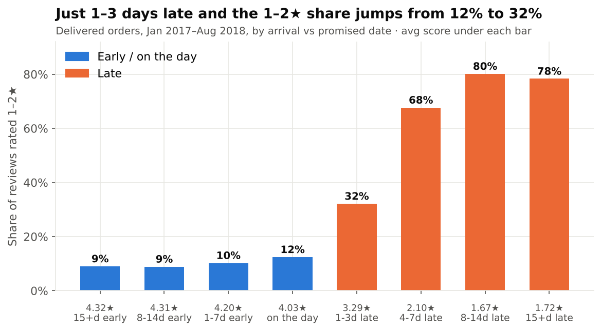
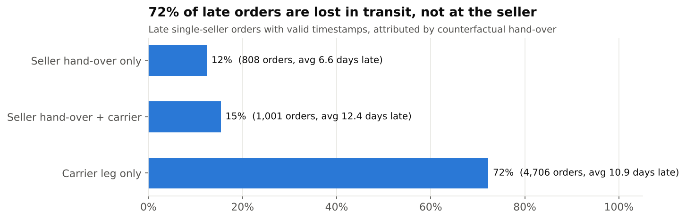
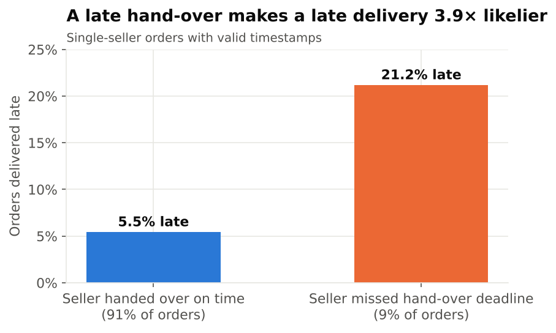
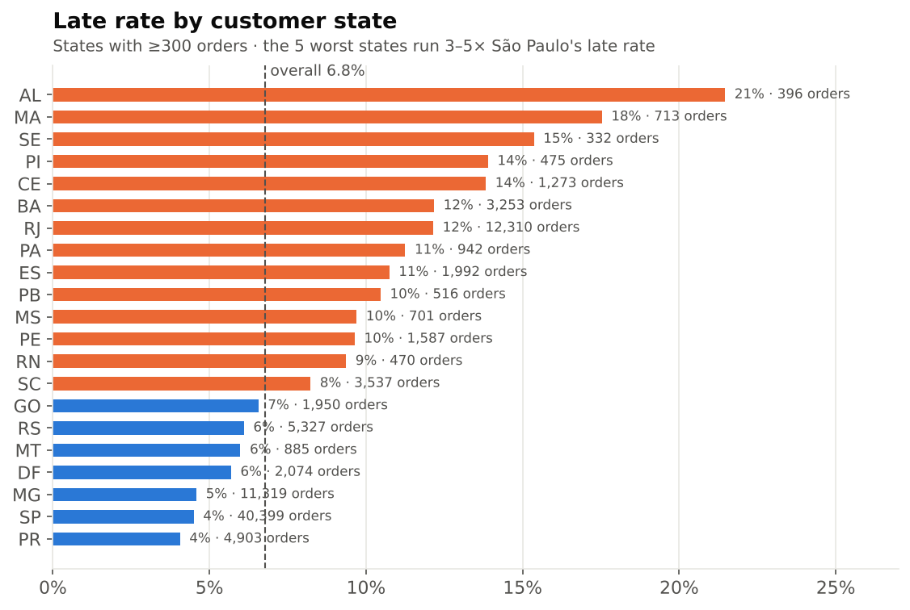
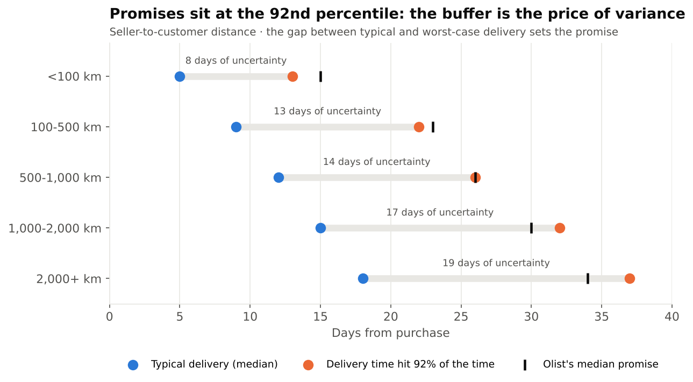
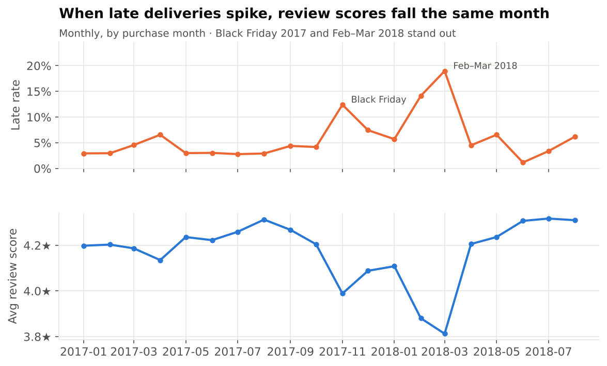

# When the Delivery Promise Breaks
### A SQL root-cause analysis of late deliveries and review scores in 96,203 real e-commerce orders

**Stack:** SQL (DuckDB) · Python (pandas for independent verification, matplotlib) · **Data:** Olist Brazilian e-commerce, Jan 2017 – Aug 2018

> **Why I built this.** In a marketplace, the delivery date shown at checkout is a promise. Myntra's
> Supply Chain Outbound team owns the parts of the journey that keep it: inventory, fulfilment,
> delivery, returns. I wanted to measure what a broken promise costs, find *where* in the journey it
> breaks, and decide what a PM should fix first. All analysis is in SQL, on real order data.

---

## TL;DR

1. **A late delivery wrecks the review.** Late orders average **2.27★** against **4.29★** for on-time orders, and are **6.7× more likely** to get a 1–2★ review (62% vs 9%). They are 6.7% of reviewed orders but **33% of all 1–2★ reviews**. Lateness drags the platform's average review score down by **0.13 stars**.
2. **It isn't a mix effect.** Comparing late and on-time orders inside the same state × product category leaves the gap almost unchanged (**1.99** vs 2.02 stars).
3. **Most delays happen in transit, not at the seller.** Of 6,515 late orders, **72% were late purely because of the carrier leg**. Sellers who miss their hand-over deadline are involved in 28%.
4. **Seller hand-over failures are concentrated.** The worst **147 sellers (top 5%)** account for **67%** of late orders where the seller also handed over late, against 39% of order volume. That's a short list to manage, not a platform-wide problem.
5. **Promises are long because delivery is unpredictable, not because they're careless.** Olist's promise sits at roughly the 92nd percentile of actual delivery time. In a 2018 backtest, no history-based promise rule beat it on both speed and reliability. **Cutting transit variance is what would allow faster promises.**

---

## Findings

### 1 · Lateness wrecks reviews



- Arriving on the promised day already gives 12% 1–2★ reviews. **One to three days late jumps that to 32%**, 4–7 days late to 68%, and 8–14 days late to 80%.
- Early delivery helps, with diminishing returns: 4.03★ on the day, 4.20★ at 1–7 days early, 4.32★ at 15+ days early.
- **Score gap:** 2.02 stars (95% CI 1.98–2.06). **Rating drag:** share of late orders × gap = **0.13 stars** off the average review score. That's how much the average would rise if late orders were rated like on-time ones.
- **Robustness:** stratifying by customer state × product category (255 cells, 87% of late orders covered) gives an adjusted gap of **1.99**. Stratifying by distance × order value × single/multi-item gives **2.04**. Where the customer is and what they bought doesn't explain the gap.
- **What customers say:** among 1–2★ reviews with text, **85%** of those on late orders mention delivery (vs 57% on on-time orders), and **52%** say some version of "not received" (vs 14%).
- **Customers review before the parcel arrives:** 74% of late-order reviews are written *before* delivery, averaging **1.84★** vs 3.53★ for those written after. That suggests much of the anger is about uncertainty ("where is my order?"), which proactive communication can address even when the delay itself can't be prevented. That's a hypothesis to test, not a finding.

### 2 · Where the delay happens: seller hand-over vs carrier transit



Every seller has a **shipping limit**, a deadline to hand the parcel to the carrier. For each late order I asked: *if the seller had handed over exactly on the deadline, would it still have been late?*

| Root cause | Share of late orders | Avg days late |
|---|---|---|
| Carrier leg only (seller on time) | **72%** (4,706) | 10.9 |
| Seller hand-over + carrier | 15% | 12.4 |
| Seller hand-over only (on time with a timely hand-over) | 12% (808) | 6.6 |

- Late orders spend **27.9 days** in carrier transit on average, against **7.9** for on-time orders. Time to hand-over roughly doubles (6.0 vs 3.0 days), but transit is where most of the extra time goes.



- When a seller misses the hand-over deadline (9% of orders), the order is late **21.2%** of the time, vs **5.5%** when they hand over on time: **3.9× likelier**.

### 3 · Seller failures are concentrated in a few sellers

- Only **20%** of 2,923 sellers ever caused a late order with a late hand-over.
- The **top 1% (30 sellers)** account for **34%** of those orders while handling 15% of volume. The **top 5% (147)** account for **67%** with 39% of volume. They're big sellers, but over-represented in late hand-overs relative to their size.
- Sellers with ≥30 orders who miss the deadline on 20%+ of orders: **90 sellers, 12% of orders**, a late rate of **10.3%** (vs 5.4% for sellers under 5%) and **3.90★** average score (vs 4.24★).

### 4 · Geography: distance, region and lanes



- The late rate climbs with distance: **4.5%** under 100 km to **12.1%** over 2,000 km.
- São Paulo (42% of orders) runs at 4.5%. **AL** is the worst state at 21%.
- **SP → RJ** is the problem lane: 1,147 late orders (18% of all late orders), second only to SP → SP, which has 3.8× the volume but a 4.7% late rate. At the platform-average late rate it would have had about 545, so it carries **602 excess late orders, the most of any lane**. It's only ~383 km (median), yet runs at 14.3% late against 6.2% for all 100–500 km orders. Distance doesn't explain it, so this one lane deserves a dedicated carrier review.
- Across the 15 biggest categories, late rates only range from 5.3% to 8.0%, and the score penalty from 1.75 to 2.25 stars. **Lateness hurts every category about equally, so the fix belongs in logistics, not in category management.**

### 5 · The promise: why it's long, and why you can't just shorten it



- Olist promises **24.3 days** on average and delivers in **12.5**. 74% of orders arrive 8+ days early.
- But in every distance band the median promise sits within 3 days of the **92nd percentile** of actual delivery time. The gap between a typical delivery and one you can keep 92% of the time is **8–19 days**.
- **Backtest** (rules learned on 2017 orders, tested on 52,777 orders from 2018):

| Promise policy | On-time rate | Avg promise |
|---|---|---|
| Olist's actual promise | 92.3% | 23.4 days |
| Lane P90 learned from 2017 | 89.9% | 20.7 days |
| Lane P95 learned from 2017 | 94.6% | 25.6 days |
| Adaptive weekly lane P90 (orders 45–135 days back) | 92.5% | 23.5 days (Olist on same orders: 92.2%, 23.4) |

- **No history-based rule beats Olist's promise on both speed and reliability.** Shorter promises break more often, and reliable ones are just as long. **The lever is variance:** shrinking the carrier tail is what would let the promise come down.

### 6 · Peaks break the promise



- Monthly late rate and average score move almost in lockstep (correlation **-0.92**).
- The late rate hit **12.4%** in November 2017 (the month of Black Friday) and **19.0%** in March 2018, when the average score fell to **3.81★** (vs 4.31★ in August 2017). Promises didn't widen to absorb these peaks.

---

## What I'd do as a PM on an outbound / fulfilment team

| # | Recommendation | Why (evidence) | Success metric | Guardrail |
|---|---|---|---|---|
| 1 | **Lane-level carrier SLA monitoring and re-allocation**, starting with SP → RJ | 72% of late orders are transit-only; SP → RJ alone carries 602 excess late orders (18% of all late orders) | Late rate and P92 transit days on the lane | Cost per shipment |
| 2 | **Proactive delay communication**: when a parcel is predicted to miss its date, notify the customer with a new ETA before they ask | 74% of late reviews are written before arrival; 52% of 1–2★ late-order texts say "not received" | 1–2★ share on late orders; "where is my order" tickets | Notification opt-outs |
| 3 | **Seller hand-over scorecard** for the worst 147 sellers: alerts before the shipping limit, then listing demotion for repeat misses | Top 5% of sellers cause 67% of seller-involved late orders; a late hand-over makes lateness 3.9× likelier | Seller hand-over-late rate | Seller churn, catalogue depth |
| 4 | **Peak-season playbook**: widen promises and pre-book carrier capacity before sale events | Late rate reached 12.4% (Nov 2017) and 19.0% (Mar 2018) | Peak-month late rate | Checkout conversion during sales |
| 5 | **Reduce variance before shortening promises**, then A/B test tighter promises on low-variance lanes (e.g. under 100 km) | Promises sit near P92; naive tightening loses on-time rate in the backtest | Conversion with a shorter promise | On-time rate ≥ current |

### Sizing (if a late order became on time, it gets on-time review behaviour)

| Scenario | Orders fixed | Avg score uplift (naive / adjusted*) | 1–2★ reviews avoided |
|---|---|---|---|
| A · Fix seller hand-over (seller-only late orders) | 782 | +0.015 / +0.015 | 377 (3.1% of all 1–2★) |
| B · Every late order on time (upper bound) | 6,378 | +0.13 / +0.13 | 3,391 (28% of all 1–2★) |

\*Adjusted = scaled by the state × category stratified gap. **The seller fix is targeted but small. The prize is in transit (scenario B), which is why recommendations 1 and 2 come first.**

---

## Method

**Data:** 99,441 orders from Olist's public dataset (9 tables: orders, items, reviews, customers, sellers, products, payments, geolocation, category names). The analysis base is **96,203 delivered orders** (99.3% reviewed).

**Cleaning rules** (each quantified in `outputs/tables/data_quality.csv`):

| Rule | Decision | Rows affected |
|---|---|---|
| R1 | Window Jan 2017 – Aug 2018 (edges are near-empty) | 349 orders dropped |
| R2 | Delivered orders with a delivery timestamp | 8 dropped |
| R3 | One review per order: the latest answered | 547 orders had 2–3 reviews |
| R4 | Days late = calendar days from promised date to delivery; on the day = on time | — |
| R5 | Leg analysis only where purchase ≤ carrier pickup ≤ delivery | 185 excluded from attribution |
| R6 | Seller attribution only for single-seller orders | 1,272 multi-seller orders excluded |
| R7 | Zip prefixes padded to 5 digits (source files drop leading zeros); median coordinates per prefix | 1,745 orders without a distance |

**Verification:** `src/verify.py` rebuilds the analysis from the raw CSVs in pandas, sharing no code with the SQL, and re-derives 24 headline numbers. **All 24 match the SQL output exactly.** `README.md` itself is rendered from the result tables (`src/build_report.py`), so no number here was typed by hand.

**Limitations**
- Observational data: the stratified comparisons rule out the obvious confounders, but this isn't an experiment.
- Brazil, 2017–18. The method transfers to Indian e-commerce; the specific numbers don't.
- Reviews come from customers who chose to leave one (99.3% coverage here, so the bias is small). 4,970 reviews were written before delivery, and they're kept because they capture the late experience.
- Root-cause attribution relies on the carrier pickup timestamp and the seller's shipping limit as recorded by Olist.
- No checkout conversion data, so the cost of long promises is argued, not measured.

---

## Run it

```bash
pip install -r requirements.txt
python src/get_data.py       # downloads the 9 raw CSVs (~125 MB) from Olist's public GitHub mirror
python src/run_analysis.py   # builds DuckDB, runs every query in sql/ → outputs/tables/*.csv
python src/verify.py         # independent pandas re-computation (24 checks)
python src/make_charts.py    # outputs/charts/*.png
python src/build_report.py   # renders this README from the results
pytest -q                    # data-quality and verification tests
```

```
sql/
  00_load.sql               raw tables
  01_build_fact.sql         cleaning rules R1–R7 → fct_orders (1 row per delivered order), root-cause view
  02_data_quality.sql       every rule quantified
  03_delivery_baseline.sql  KPIs, dose-response by lateness bucket
  04_review_impact.sql      rating drag, 95% CI, review timing
  05_confounder_control.sql stratified (within-cell) gaps
  06_root_cause.sql         seller vs carrier attribution, hand-over effect, leg durations
  07_sellers.sql            concentration (Pareto), seller scorecard
  08_region_category.sql    states, distance bands, lanes, categories
  09_promise_backtest.sql   padding, static and adaptive promise backtests, delivery-time spread
  10_review_text_trend.sql  Portuguese review-text topics, monthly trend
  11_opportunity_sizing.sql scenario sizing
```

**Data source:** Olist, [Brazilian E-Commerce Public Dataset](https://www.kaggle.com/datasets/olistbr/brazilian-ecommerce), mirrored by Olist at [github.com/olist/work-at-olist-data](https://github.com/olist/work-at-olist-data) (MIT licence). Real, anonymised orders.
